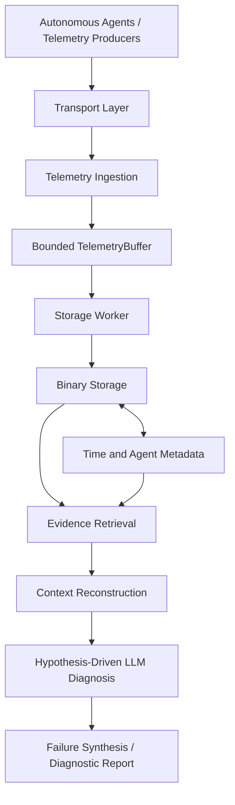

# Failure Synthesis System
### Distributed-System Failure Reconstruction

**Status:** In Progress  
**Languages:** Java, Python  
**Domain:** Distributed Systems · Binary Storage · Autonomous Systems · LLM-Based Diagnosis

## 1. Problem Statement

Autonomous systems often operate as part of a larger fleet in which multiple agents produce telemetry, undergo state transitions, communicate, and interact with their environment.

When an agent deviates from its expected behavior or fails, the cause may not be visible in that agent's own telemetry. The relevant evidence could be distributed across multiple agents and events that occurred before the failure.

For example, a drone's unexpected deviation might be associated with its own navigation state, another drone's sensor malfunction, a communication interaction, or an earlier formation change. Diagnosing the incident requires reconstructing the relevant sequence of events rather than examining a single error message.

Conventional logging and observability help retain and search events, but reconstructing a failure also requires efficient historical retrieval, preservation of forensic evidence, and reasoning over the relationships between events.

**Failure Synthesis System aims to bridge this gap by combining crash-resilient binary telemetry storage with evidence-driven, hypothesis-based failure diagnosis.**

The system is being designed to investigate plausible root causes by correlating temporally relevant telemetry across agents, retrieving supporting or contradictory evidence, and using domain-aware LLM reasoning to synthesize a diagnosis.

## 2. Project Objectives

The system is being developed around five objectives:

- **Reliable telemetry preservation:** retain structured binary events and recover valid stored records following a server crash.
- **Efficient historical retrieval:** locate relevant events by time range, agent identity, and event type without scanning the entire telemetry history.
- **Heterogeneous event support:** accommodate different event types, payload schemas, and sampling frequencies.
- **Cross-agent evidence reconstruction:** assemble relevant events from multiple agents around an incident.
- **Hypothesis-driven diagnosis:** use retrieved evidence and domain knowledge to investigate potential root causes instead of relying only on direct error-code lookup.

The central design principle is to separate the telemetry infrastructure from the diagnostic intelligence layer. Storage and retrieval must remain useful independently of any particular LLM.

## 3. High-Level Architecture



The diagram represents the intended end-to-end architecture. Not every component or connection shown is implemented yet.

### Component responsibilities

| Component | Responsibility |
|---|---|
| Transport layer | Receive complete telemetry messages through a transport-specific adapter. |
| Telemetry ingestion | Validate the configured binary envelope and submit accepted records to the buffer. |
| `TelemetryBuffer` | Decouple message reception from storage using bounded in-memory buffering. |
| `StorageWorker` | Consume accepted records and write them into the storage layer. |
| Binary storage | Organize records into time-partitioned segments and fixed-size blocks. |
| Metadata stores | Track segment information, block allocation, and per-agent block mappings. |
| Evidence retrieval | Narrow a query to relevant segments, agents, blocks, and records. |
| Context reconstruction | Assemble temporally relevant evidence across agents. |
| Diagnostic reasoning | Evaluate potential failure hypotheses against retrieved evidence. |

## 4. Telemetry Contract and Binary Ingestion

The system assumes structured binary telemetry with known schemas. It does not assume that every agent produces the same event type or sends events at a fixed frequency.

### Configurable message envelope

A representative envelope is:

| Byte range | Field | Representation |
|---|---|---|
| 0–3 | Agent ID | `UINT32` |
| 4–11 | Producer timestamp | `INT64` |
| 12–15 | Payload length | `UINT32` |
| 16–19 | Event type | `UINT32` |
| 20 onward | Payload | Variable-length bytes |

This is an example configuration, not a hardcoded universal format.

Field offsets, widths, numeric representations, and byte order are defined through configuration. A different deployment can use a different envelope layout without requiring the storage implementation to be rewritten.

The event type identifies the payload schema or decoding rules. The payload may represent a fixed-width structure or variable-length event data.

### Ingestion principles

- Accept complete application messages from the transport client.
- Validate envelope boundaries and payload lengths before accepting records.
- Preserve the original record bytes rather than unnecessarily deserializing and reconstructing them.
- Extract only the metadata required for validation, routing, and storage.
- Reject malformed or oversized records explicitly.
- Keep transport-specific concepts out of the generic ingestion interface.

The MQTT client is responsible for MQTT protocol framing and delivery. The application ingestion layer operates on complete message payloads.

### Concurrency model

The intended ingestion path uses concurrent message handling to keep reception separate from disk persistence.

Multiple ingestion tasks submit records to the existing bounded `TelemetryBuffer`. A storage worker consumes accepted records and writes them into the storage layer.

Java virtual threads are being considered for short-lived ingestion tasks where appropriate. They provide lightweight concurrency, but they do not eliminate the need for bounded memory, explicit overload handling, or correct synchronization.

The design does not require one thread per autonomous agent and does not introduce a second application-level payload queue.

## 5. Binary Storage Architecture

The storage layer is designed around time-partitioned segments, per-agent block organization, and length-framed records.

### Time-partitioned segments

Telemetry is organized into segments representing bounded periods of ingestion or event history.

Segments provide the first level of retrieval narrowing. Rather than searching all stored telemetry, the system identifies the segments that overlap the requested time range.

Active segments accept new records. Once sealed, a segment becomes immutable, simplifying subsequent retrieval and metadata handling.

The exact relationship between segment rotation and producer timestamps must account for possible clock skew and out-of-order delivery.

### Per-agent block organization

Within a segment, records are organized into fixed-size storage blocks. Segment metadata maps agent identifiers to the blocks containing their records.

For example:

```text
Segment
├── Metadata
│   ├── Agent 474 → Block IDs [2, 5, 8]
│   ├── Agent 298 → Block IDs [1, 5]
│   └── Agent 281 → Block IDs [3, 8]
└── Binary Block Storage
    ├── Block 1
    ├── Block 2
    ├── ...
    └── Block N
```

This organization allows retrieval to narrow its search to the blocks associated with the requested agent, instead of scanning every block in a segment.

Blocks are allocated as needed rather than reserving equal storage space for every agent.

### Record framing

Each stored record contains the metadata needed to identify and locate its payload, including:

- Record or event identity where available
- Timestamp
- Record length
- Event type
- Payload bytes

The record length allows the reader to locate the next record without assuming that every payload has the same size.

Records do not cross block boundaries. If a record cannot fit in the remaining space of a block, that space is left unused and another block is selected or allocated.

This avoids splitting a record across blocks and simplifies record validation and recovery.

### Block metadata

The block metadata tracks information such as:

- Block ID
- Physical storage offset
- Used length
- Start timestamp
- End timestamp

The physical block offset is derived from the block ID and configured block size. Used length identifies the valid portion of the block.

Timestamp metadata helps narrow retrieval, but it must not be treated as proof that every record inside a block is globally ordered by event time.

## 6. Crash Recovery and Durability

Failure Synthesis is intended to preserve forensic evidence even if the central ingestion/storage server crashes.

The design distinguishes two acceptance levels:

**`BUFFER_ACCEPTED`**

The complete record has been copied into the bounded in-memory buffer and accepted by the ingestion pipeline. This is an in-memory acceptance boundary, not a durability guarantee.

**`DURABLY_STORED`**

The record has crossed the storage layer's explicitly defined durability boundary. The exact guarantee depends on record writes, filesystem synchronization, and the recoverability of the metadata required to locate the record.

### Recovery strategy

The intended recovery procedure is to:

1. Identify active segments and blocks.
2. Validate framed records in the active block tails.
3. Identify incomplete or corrupt trailing records.
4. Remove or truncate only the invalid trailing portion, preserving earlier valid records.
5. Reconcile metadata with the valid stored records where necessary.
6. Resume ingestion using the recovered active segment state.

Sealed segments remain immutable.

The system does not claim that volatile buffer contents survive a process crash. A record acknowledged at the buffer-acceptance boundary may still be lost before persistence. Stronger acknowledgement guarantees require the acknowledgement boundary to follow durable storage.

Recovery correctness must be validated against interrupted writes, metadata inconsistencies, and process crashes before claiming complete crash-safety guarantees.

## 7. Retrieval and Evidence Reconstruction

The retrieval layer is designed to support bounded, time-scoped queries.

Representative query forms include:

```text
retrieve(agent_id, start_time, end_time)
retrieve(all_agents, start_time, end_time)
retrieve(agent_id, start_time, end_time, event_type)
```

The time range is required. Agent and event-type filters narrow the query further.

### Retrieval path

1. Identify segments overlapping the requested time range.
2. Use segment metadata to identify relevant agents and blocks.
3. Read only the relevant block ranges.
4. Validate record framing and filter records by their actual timestamps and event types.
5. Return the matching events for further context reconstruction.

A query involving multiple agents may require merging records from multiple blocks. Because producer clocks may be skewed and records may arrive out of order, ingestion order must not be mistaken for globally accurate event-time order.

The retrieval layer should preserve timestamp provenance and apply an explicit ordering policy when chronological output is required.

### Cross-agent reconstruction

A failure may involve more than the agent that ultimately deviated.

For example, an incident investigation could retrieve:

- Navigation or state-transition events from the affected agent.
- Sensor or operational errors from a nearby agent.
- Communication events connecting the agents.
- Formation membership changes and task events preceding the deviation.

The objective is to assemble a bounded, relevant evidence set rather than indiscriminately supplying the entire fleet's telemetry to an LLM.

## 8. Domain-Aware Diagnostic Reasoning

The diagnostic layer is intended to move beyond searching for known error strings.

The proposed workflow is:

1. **Incident identification:** establish the agent, approximate failure time, and observed symptom.
2. **Hypothesis formulation:** identify plausible explanations for the observed behavior.
3. **Evidence retrieval:** fetch temporally relevant telemetry from the affected agent and potentially related agents.
4. **Domain-aware decoding:** interpret payload fields and status codes using configured schemas and available domain documentation.
5. **Evidence evaluation:** examine which events support, contradict, or fail to establish each hypothesis.
6. **Targeted follow-up retrieval:** obtain additional evidence when the initial context is insufficient.
7. **Failure synthesis:** produce an explanation grounded in the available evidence, including uncertainty and unresolved questions.

### Constrained payload interpretation

Binary payloads should not be assigned arbitrary meanings merely because their bytes can be decoded.

For example, if configuration or domain documentation defines the first two payload bytes as a status code, the decoding layer can interpret those bytes accordingly. If the meaning of another field is unknown, the system should preserve it as uninterpreted data rather than inventing a semantic interpretation.

This separates deterministic decoding from probabilistic reasoning:

- Configuration and domain knowledge establish what the telemetry fields mean.
- The retrieval layer establishes which events are relevant.
- The LLM evaluates the evidence and synthesizes a potential explanation.

The intended output is a reasoned, evidence-grounded diagnosis—not an unsupported assertion that a particular event definitively caused the failure.

## 9. Current Implementation Status

The following status reflects the current development direction and should be updated as individual components are verified.

| Component | Status |
|---|---|
| Binary storage layout using time-partitioned segments and per-agent blocks | Implemented |
| Length-framed records and configurable envelope design | Core format defined; configuration and validation work is ongoing |
| Active-block crash-recovery mechanisms | Implemented in the storage work; recovery guarantees require validation against crash scenarios |
| Existing bounded `TelemetryBuffer` | Present in the storage architecture; concurrency and integration behavior require testing |
| Concurrent telemetry ingestion | In progress |
| Generic transport abstraction and MQTT adapter | Architecture defined; implementation in progress |
| Explicit buffer-acceptance versus durable-storage acknowledgement policies | Design defined; end-to-end behavior not yet finalized |
| Efficient time-, agent-, and event-type-based evidence retrieval | In progress |
| Cross-agent context reconstruction | Planned downstream capability |
| Domain-aware payload decoding from configuration and documentation | Planned |
| Hypothesis-driven LLM diagnosis and failure synthesis | Planned downstream capability |
| End-to-end crash, concurrency, and load testing | Pending validation |

**Implementation note:** A design decision is not equivalent to a completed feature. The status table should be revised as code, integration tests, and recovery tests establish each capability.

## 10. Key Design Decisions

The current design follows these principles:

- **Binary-first ingestion:** retain original structured records without unnecessary object creation or serialization.
- **Configurable wire format:** avoid hardcoding one producer's envelope into the storage layer.
- **Bounded buffering:** separate message reception from persistence without introducing unbounded application queues.
- **Time-partitioned retrieval:** narrow the search before reading individual records.
- **Per-agent block indexing:** reduce unnecessary scanning when investigating one or a subset of agents.
- **Length-framed records:** support heterogeneous payload sizes while keeping record boundaries explicit.
- **Explicit durability boundaries:** distinguish in-memory acceptance from crash-survivable persistence.
- **Separation of concerns:** keep transport, ingestion, storage, retrieval, decoding, and reasoning independently understandable.
- **Evidence-driven diagnosis:** require diagnostic explanations to be grounded in retrieved events and known field semantics.

## 11. Planned Development Roadmap

1. Complete and test the binary storage and recovery paths.
2. Finalize the concurrent buffer lifecycle, wraparound correctness, and shutdown behavior.
3. Integrate transport-independent ingestion with the existing storage APIs.
4. Implement the MQTT adapter and define acknowledgement behavior for accepted, rejected, and durably stored messages.
5. Complete bounded time- and agent-based retrieval with explicit ordering semantics.
6. Add schema-driven payload decoding and domain documentation support.
7. Implement cross-agent evidence reconstruction and bounded diagnostic context.
8. Integrate hypothesis-driven LLM reasoning and evidence-grounded failure reports.
9. Validate recovery, duplicate delivery, concurrency, retrieval correctness, and throughput under representative workloads.

## 12. Intended Outcome

Failure Synthesis System aims to turn distributed telemetry into usable forensic evidence.

Its distinguishing idea is the combination of **low-level binary storage and recovery infrastructure with a higher-level diagnostic process that reconstructs cross-agent events and evaluates potential failure causes against evidence**.

The storage layer preserves and locates the data. The retrieval layer assembles the relevant history. The diagnostic layer uses that history to investigate why a failure may have occurred.
